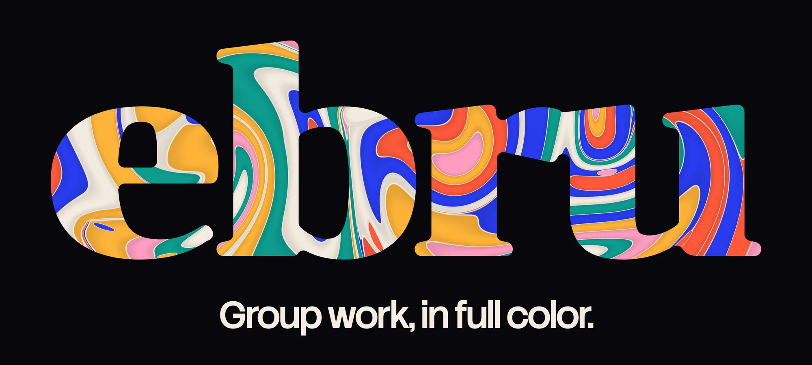
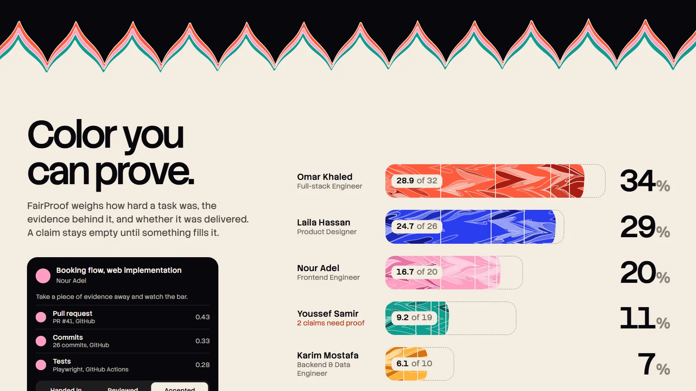
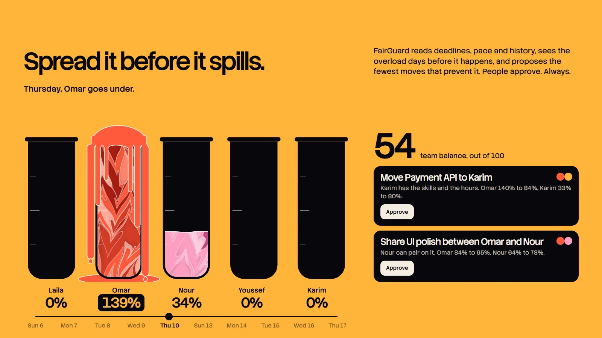
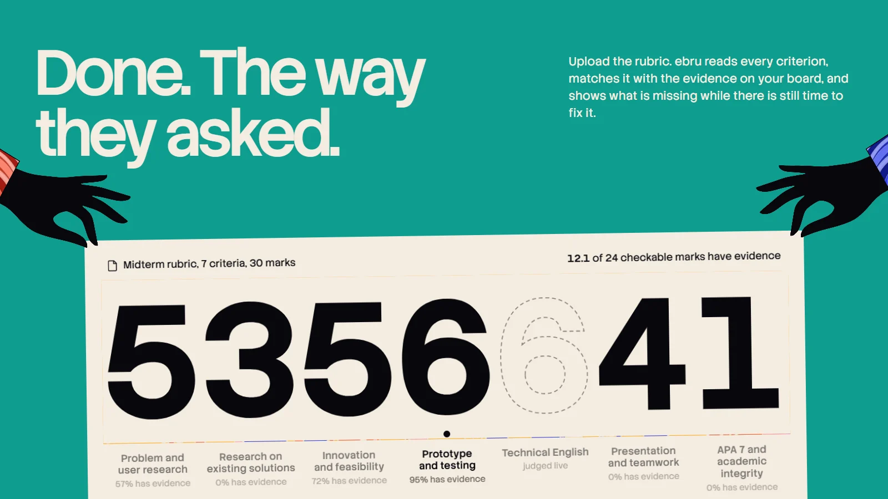
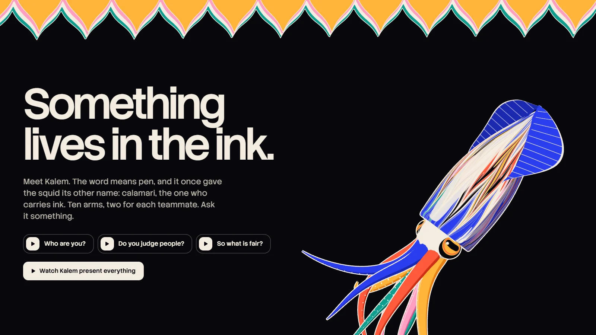
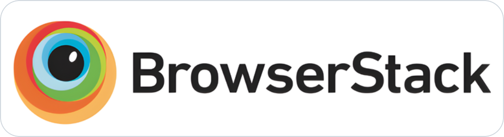

<div align="center">

<a href="https://ebru.ink"></a>

<br />
<br />

<p>
An AI-powered board for teamwork and workload evaluation.<br />
It shows who really did what, checks the work against the rubric,<br />
and spreads the load before anyone drowns.
</p>

<p>
<a href="https://ebru.ink"><b>Visit ebru.ink</b></a>
&nbsp;·&nbsp;
<a href="https://app.ebru.ink"><b>Open the board</b></a>
&nbsp;·&nbsp;
<a href="https://kalem.ebru.ink"><b>Watch Kalem present</b></a>
</p>

<p>
<a href="https://ebru.ink"></a>
<a href="LICENSE"></a>
<a href="https://www.browserstack.com"></a>
</p>

</div>

<br />

## The idea

*Ebru* is the old art of painting with ink on water. Every drop moves the others, and every drop stays visible.

Group work should feel the same. It rarely does. Five people start a project. By week two, one of them is doing everything, one has quietly drifted off, and nobody sees it coming until the deadline is about to burst.

**ebru turns a team's work into one picture that everybody can read, while there is still time to change it.**

## Why it matters

- In 23 student teams, the wider the gap between the work people *reported* and the work *on record*, the lower the result of the project (Berrezueta-Guzman et al., 2025).
- A review of 57 studies found the same challenge again and again: low and uneven participation (Donelan & Kear, 2024).

## What ebru does

<table>
  <tr>
    <td width="50%" valign="top">
      
      <p><b>FairProof.</b> A claim stays empty until proof fills it. Difficulty, evidence and delivery make one number, and every number comes with its reasons in plain words.</p>
    </td>
    <td width="50%" valign="top">
      
      <p><b>FairGuard.</b> Sees Thursday on Monday, and proposes the smallest move that helps. Nothing changes until a person says yes.</p>
    </td>
  </tr>
  <tr>
    <td width="50%" valign="top">
      
      <p><b>Rubric check.</b> Upload the rubric. ebru matches every criterion with the evidence on the board, and shows what is missing while there is still time.</p>
    </td>
    <td width="50%" valign="top">
      
      <p><b>Kalem.</b> The squid who lives in the ink. It explains the board in plain words, and every score it gives comes with its reasons.</p>
    </td>
  </tr>
</table>

## This repository

This is the website at **[ebru.ink](https://ebru.ink)**: the problem, the three engines at work, and Kalem. Every demo on the page runs the same engine as the board, on a fictional sample team, so every number you see is computed live in your browser.

It also holds **ask.html**, three questions about group work that take thirty seconds and feed our presentation. Nobody's name is kept.

The board, our presentation and Kalem's presentation live in their own repositories.

## Made for every screen

Phones, laptops and projectors. The ink is painted live and keeps its pace on its own, and the page stays calm for people who prefer less motion.

## Run it locally

You need [Node.js](https://nodejs.org) 22 or newer.

```bash
npm install
npm run dev      # http://localhost:5173
npm run build    # the finished site, in dist/
```

The buttons that open the board and Kalem's presentation lead to the live sites. To send them somewhere else, copy `.env.example` to `.env.local`.

## Credits

Made for the Technical English midterm of Foundation Year Engineering, NOVA University Lisbon and The Knowledge Hub, November 2026.

The ink follows the published model of mathematical marbling (Lu, Jaffer et al., 2012). Type: Stack Sans, under the SIL Open Font License. Team Atlas, its tasks and its scores are fictional sample data.

<br />

<div align="center">

### Sponsored by

<a href="https://www.browserstack.com"></a>

This project is tested with BrowserStack. BrowserStack sponsors the testing infrastructure for this project.

</div>

<br />

## License

[MIT](LICENSE) © 2026 Mohamed Ahmed Magdy Ahmed
